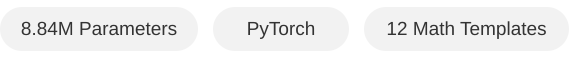
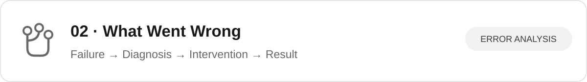
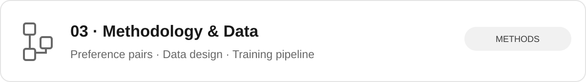
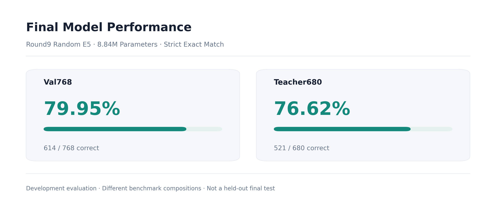
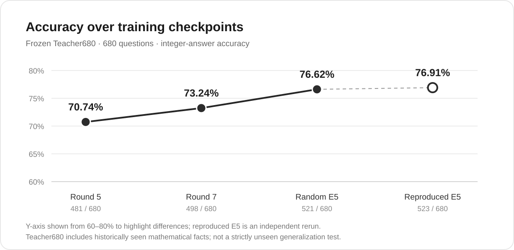
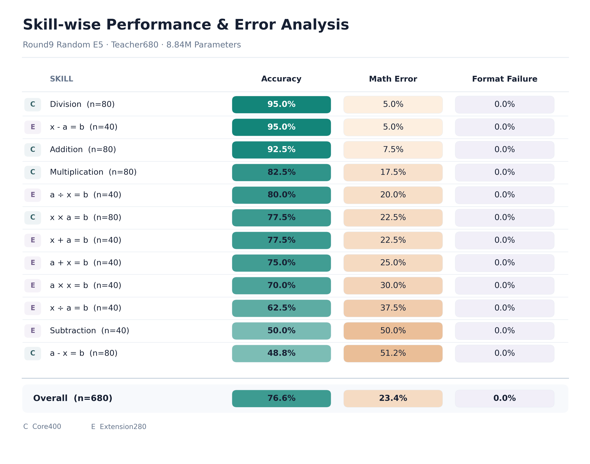
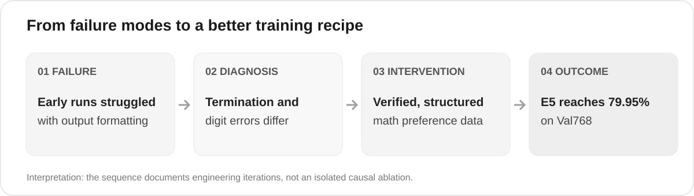
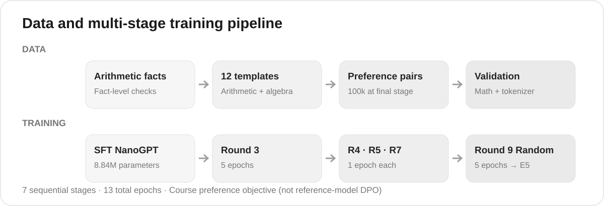

<div align="center">

# Teaching a Tiny GPT to Solve Math Problems

**Preference Optimization · Data Synthesis · Failure Analysis**



*A compact study of how structured preference data and staged fine-tuning can improve arithmetic and algebra performance in a character-level language model.*

<p align="center"></p>

<sub>Conceptual illustration of the project goal; example answers are illustrative, not a measured before-and-after evaluation.</sub>

</div>

<!-- The SVG panels act as clickable navigation cards on GitHub. -->

<a href="#key-results"></a>

<a href="#what-went-wrong"></a>

<a href="#methodology-and-data"></a>

---

## Key Results

<p align="center"></p>

*Historical selected Round9 Random E5. These are two different development benchmarks, not a held-out final test; their percentages should not be interpreted as directly comparable.*

**How did capability change across training iterations?** We compared selected checkpoints on the same frozen **Teacher680 development set**, then independently reran the selected E5 training procedure.

<p align="center"></p>

<div align="center">
<table>
  <thead>
    <tr><th align="center">Checkpoint</th><th align="center">Teacher680 (correct / 680)</th><th align="center">Accuracy</th></tr>
  </thead>
  <tbody>
    <tr><td align="center">Round 5 — Original</td><td align="center">481 / 680</td><td align="center">70.74%</td></tr>
    <tr><td align="center">Round 7 — Replay</td><td align="center">498 / 680</td><td align="center">73.24%</td></tr>
    <tr><td align="center">Round 9 — Random E5 (selected)</td><td align="center">521 / 680</td><td align="center"><strong>76.62%</strong></td></tr>
    <tr><td align="center">Independently reproduced E5</td><td align="center">523 / 680</td><td align="center"><strong>76.91%</strong></td></tr>
  </tbody>
</table>
</div>

<p align="center"></p>

*The selected historical Random E5 is evaluated on Teacher680 (n=680). The figure separates mathematical errors from format failures; category counts differ, and Teacher680 includes facts seen during historical training. This is a diagnostic breakdown, not evidence of strictly unseen-fact generalization.*

---

## What Went Wrong

**The central challenge was not simply making the training loss smaller.** Early experiments exposed distinct failure modes: generating the required answer format, stopping at the right place, and producing correct numerical digits.

<p align="center"></p>

| Observed issue | Diagnostic interpretation | Response in later experiments |
|:--|:--|:--|
| Early refusal-oriented training: 0/256 correct on a development probe | Preference training alone did not reliably yield well-formed answers | Revisited rejected completions and response structure |
| Format and stopping behavior could improve without correct arithmetic | Surface compliance and mathematical correctness are different objectives | Added answer-focused/termination diagnostics and numerical grading |
| Some arithmetic families and digit patterns remained weak | Memorized facts can outperform rule-based generalization | Used verified 12-template examples, staged continuation, and replay |

**A remaining error in the selected model:**

```text
Prompt:       3*17=?
Model output:  The answer is 41 because 3*17 equals 41.
Correct:      51
```

The instructor's original eight printed prompts produced **6/8 correct answers**, or **4/5 distinct questions correct**. The duplicate multiplication question fails twice; those outputs are preserved rather than edited. This is a concrete reminder that strong development accuracy does not imply reliable arithmetic algorithms.

These iterations describe the observed engineering process; because several training conditions changed over time, they should **not** be interpreted as a fully controlled causal ablation.

---

## Methodology and Data

<p align="center"></p>

### 1. Model and preference data

The starting point is the **course-provided character-level NanoGPT**, with **8,838,852 parameters**, six Transformer layers, six attention heads, embedding dimension 348, a vocabulary of 74 characters, and context length 256.

Preference pairs use an answer-and-explanation **chosen** completion and a refusal **rejected** completion. Example:

```text
Question:  x*8=48,x=?
Chosen:    x*8=48,x=? The answer is 6 because 48/8 equals 6.
Rejected:  x*8=48,x=? Sorry, I don't know.
```

Data generation covers **12 arithmetic and algebra templates**: addition, subtraction, multiplication, division, and eight arrangements of one-variable equations. Examples are mathematically checked, and development partitions use canonical mathematical-fact keys to reduce fact overlap. The final Random-stage dataset contains **100,000** preference pairs.

### 2. The training objective

Training follows the instructor's **course preference loss**, using teacher-forced, full-sequence mean token log probabilities:

$$
\mathcal L = -\log\sigma\!\left(\frac{\ell_+ - \ell_-}{\beta}\right) - 0.1\ell_+, \qquad \beta=0.5
$$

Here, $\ell_+$ and $\ell_-$ are the chosen and rejected sequence log probabilities. **This is a simplified course-defined preference objective, not standard reference-model DPO.** The project uses AdamW and cosine learning-rate scheduling, including optimizer restarts across recorded stages.

### 3. Historical training curriculum

| Stage | Training | Epochs |
|:--|:--|--:|
| Round 3 | Structured arithmetic/algebra preferences | 5 |
| Round 4 | Matched treatment continuation | 1 |
| Round 5 | Original preference continuation | 1 |
| Round 7 | Replay continuation | 1 |
| Round 9 | Random E1 | 1 |
| Round 9 | Random E2, AdamW restarted | 1 |
| Round 9 | Random E3–E5, continued cosine schedule | 3 |
| **Total** | **Seven sequential stages** | **13** |

### Code and reproduction notes

The validated, executed notebook records the full historical replay and the original instructor test outputs; it has not yet been added to this curated repository. This **portfolio repository is a curated showcase**, not the complete archive: a fresh historical replay also requires the original SFT checkpoint, the frozen stage datasets and manifests, supporting scripts, and the archived selected E5 checkpoint. Do not run the notebook with only the files shown here and expect the complete historical replay.

The selected model's development metrics are also saved in [`results/verified-metrics.json`](results/verified-metrics.json). Final model weights and the complete training archive are intentionally not bundled into this lightweight repository.

---

<details>
<summary><strong>Project scope, attribution, and limitations</strong></summary>

This was an **individual NTU SC3000/CZ3005 lab project**. The original NanoGPT architecture, initial pretrained checkpoint, and notebook scaffold were supplied by the course. The work documented here covers preference dataset development, training experiments, staged evaluation, failure diagnosis, and reproducibility analysis. External code and references should be credited alongside their corresponding implementation where used.

Limits include an extremely small language model, development-set evaluation, known arithmetic errors, seen-fact contamination in Teacher680, and nonidentical model weights across otherwise closely matching reproductions. The TA's private test results are unavailable.

</details>
